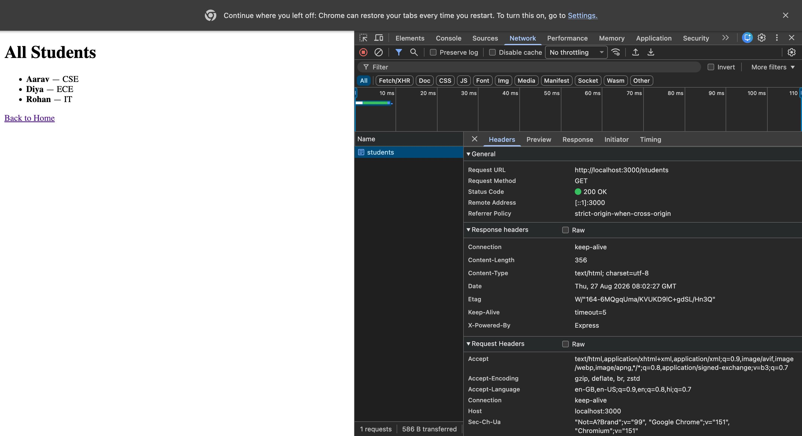

# Day 3: HTTP Requests, DevTools, cURL, Postman, and fetch()

## Overview

This folder contains the notes, practical exercises, and screenshots for Lecture 04 of Backend Development. The lecture focuses on understanding HTTP requests and responses and learning how to inspect and test APIs using different tools.

## Topics Covered

- Anatomy of an HTTP Request
- Anatomy of an HTTP Response
- HTTP Methods: GET, POST, PUT, and DELETE
- Inspecting Requests Using Browser DevTools
- Sending Requests Using cURL
- API Testing Using Postman
- Sending Requests Using JavaScript `fetch()`
- Comparing Browser DevTools, cURL, and Postman
- Flask Server Inspection
- Client-Server Communication

## Tools and Technologies

- JavaScript
- Express.js
- Flask
- Browser Developer Tools
- cURL
- Postman
- HTTP

## Practical Tasks

### Task 1: Inspect a Request Using Browser DevTools

- Start the Express server.
- Open the browser's Network tab.
- Visit `http://localhost:3000/students`.
- Inspect the request method, status code, headers, and response body.

### Task 2: Send Requests Using cURL

- Retrieve all students.
- Inspect request and response headers using `curl -v`.
- Retrieve a student using their ID.
- Test a request for a student who does not exist.
- Display response headers using `curl -i`.

### Task 3: Send Requests Using Postman

- Send a GET request to retrieve all students.
- Inspect the response status, body, and headers.
- Add an `Accept: application/json` header.
- Practise sending a POST request.
- Save the request in a Student Management API collection.

### Task 4: Same Request, Three Tools

- Send `GET http://localhost:3000/students/2` using Browser DevTools, cURL, and Postman.
- Compare the response body and headers returned by each tool.

### Task 5: Flask Server Inspection

- Start the Flask server.
- Send a request using cURL.
- Test `http://localhost:5000/students` using Postman.
- Observe how the same HTTP protocol works with different server implementations.

## JavaScript fetch()

The `fetch()` API allows JavaScript to send HTTP requests to a backend server.

Example: Fetch all students

```javascript
fetch("http://localhost:3000/students")
  .then(response => response.json())
  .then(students => console.log(students))
  .catch(error => console.error("Error:", error));
```

Example: Create a student

```javascript
fetch("http://localhost:3000/students", {
  method: "POST",
  headers: {
    "Content-Type": "application/json"
  },
  body: JSON.stringify({
    name: "Priya",
    branch: "CSE"
  })
})
  .then(response => response.json())
  .then(data => console.log(data))
  .catch(error => console.error("Error:", error));
```

## Screenshots

### Screenshot 1



### Screenshot 2


### Screenshot 3


### Screenshot 4


### Screenshot 5


### Screenshot 6


### Screenshot 7


### Screenshot 8


### Screenshot 9


## Key Learnings

- Understood the structure of HTTP requests and responses.
- Learned the purpose of GET, POST, PUT, and DELETE methods.
- Practised inspecting request and response headers.
- Learned to test APIs using Browser DevTools, cURL, and Postman.
- Practised sending HTTP requests using JavaScript `fetch()`.
- Compared requests across Express.js and Flask servers.

## Lab Exercise

- Inspect `GET /students` using Browser DevTools.
- Use cURL to retrieve student 3.
- Test the Flask `/students` endpoint using Postman.
- Write a JavaScript `fetch()` function to filter students by the CSE branch.
- Identify response headers using `curl -v`.

## Conclusion

This lecture provided practical experience with HTTP request-response cycles and API testing tools. These concepts are essential for debugging backend applications and understanding how clients communicate with servers.

---
